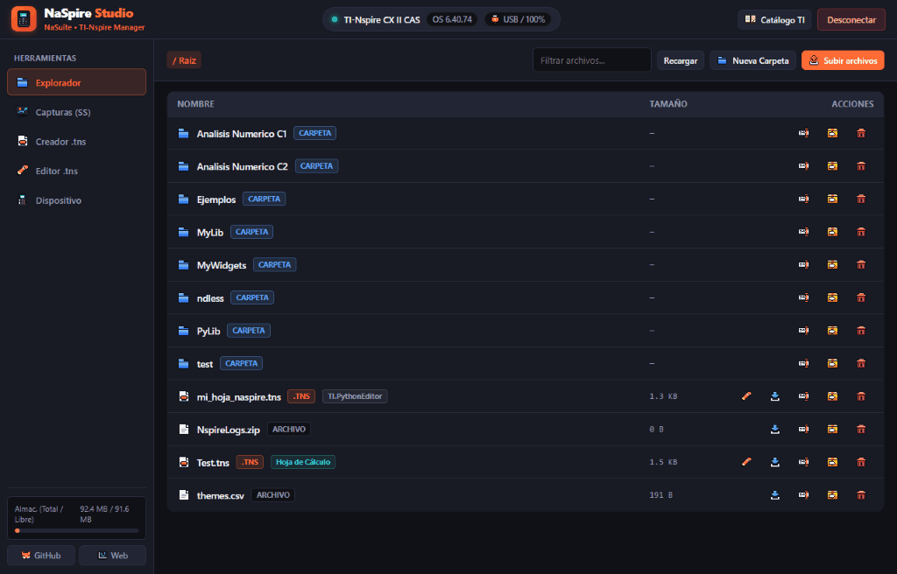
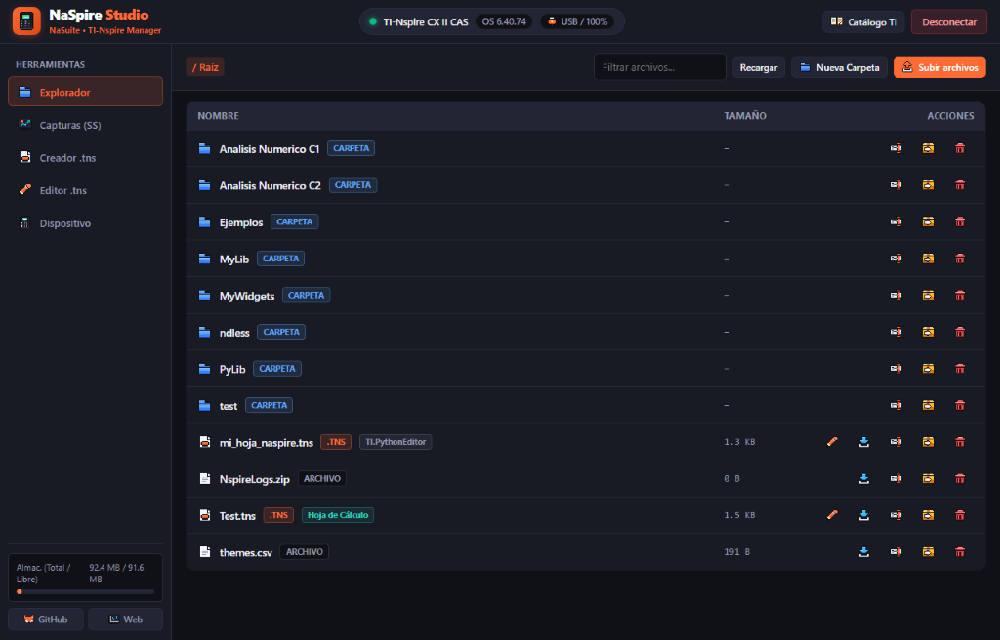
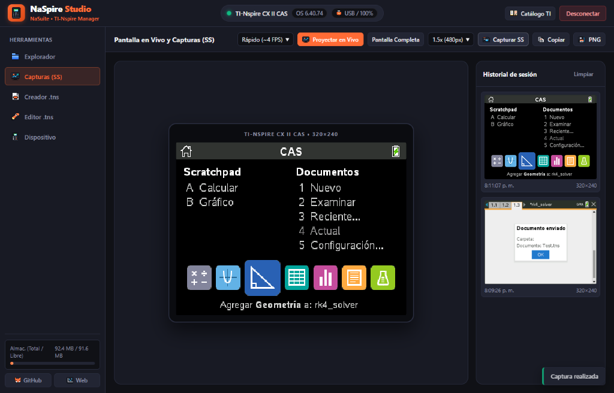
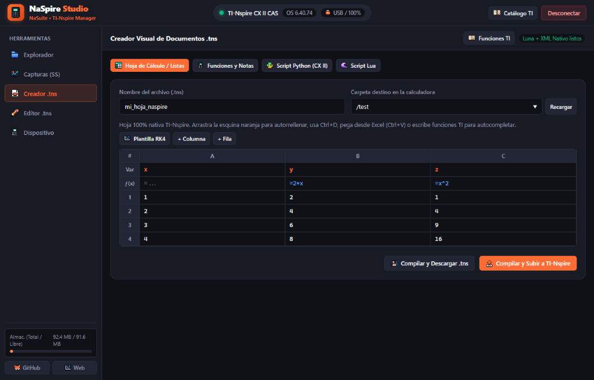
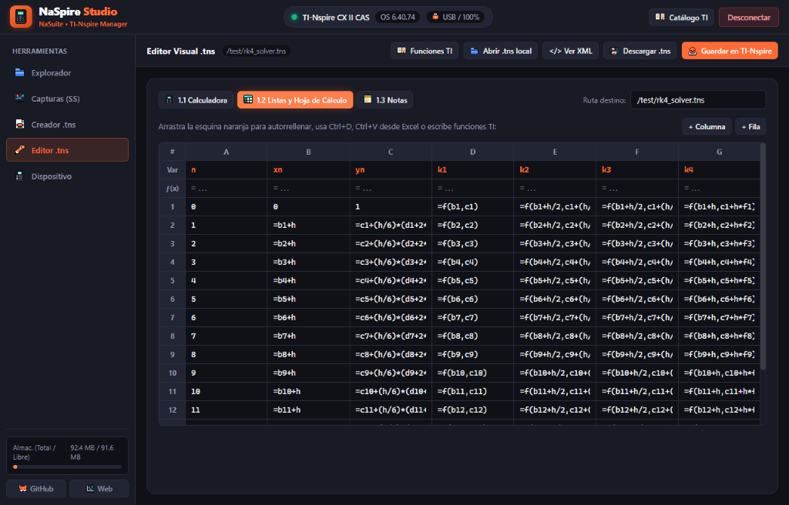

<div align="center">


# NaSpire Studio v1.0.0

**El entorno de escritorio portable, visual y nativo para calculadoras TI-Nspire — parte de NaSuite.**

[-FF6B35?style=for-the-badge&logo=windows)](https://github.com/NachoFari/NaSpire/releases/latest)

[](https://github.com/NachoFari/NaSpire/releases)
[](https://www.python.org/)
[](https://github.com/NachoFari/NaSpire)
[](https://github.com/NachoFari)

*Sin depender del navegador ni drivers propietarios pesados. Conecta tu TI-Nspire, organiza archivos, proyecta la pantalla en vivo y crea documentos `.tns` nativos en segundos.*

</div>

---

##  Descarga e Instalación

### Opción 1: Instalador de Windows (`NaSpire-Setup-v1.0.0.exe`) — Recomendado
1. Descarga la última versión desde **[Releases (v1.0.0)](https://github.com/NachoFari/NaSpire/releases/latest)**.
2. Ejecuta **`NaSpire-Setup-v1.0.0.exe`**.
3. Se instalará con acceso directo en el Escritorio, Menú Inicio, desinstalador y **actualizaciones automáticas** vía GitHub Releases.

### Opción 2: Versión 100% Portable (`NaSpire-v1.0.0-Windows-Portable.zip`)
1. Descarga y descomprime el `.zip` en cualquier carpeta o pendrive.
2. Ejecuta **`NaSpire.exe`** directamente en cualquier computador con Windows 10/11 sin instalar Python ni librerías.

### Opción 3: Desde Código Fuente
```bash
git clone https://github.com/NachoFari/NaSpire.git
cd NaSpire
python -m venv .venv
.venv\Scripts\pip install -r requirements.txt
.venv\Scripts\python app.py
```

Para compilar el ejecutable (`NaSpire.exe`), el instalador (`NaSpire-Setup-v1.0.0.exe`) y el ZIP portable:
```bash
.venv\Scripts\python scripts/build.py
```

---

##  Galería

<div align="center">

[](docs/screenshots/gallery_showcase.gif)

*Vista previa en carrusel de la interfaz de NaSpire Studio v1.0.0*

</div>

<details>
<summary><b>Ver capturas individuales por sección</b></summary>
<br>

| Explorador de Archivos y Etiquetas `.tns` | Proyector en Vivo y Capturas (SS) |
| :---: | :---: |
| [](docs/screenshots/showcase_explorer.png) | [](docs/screenshots/showcase_projector.png) |

| Creador Visual `.tns` (Hoja Nativa / Python / Lua) | Editor Visual `.tns` por Pestañas (RK4 Solver) |
| :---: | :---: |
| [](docs/screenshots/showcase_creator.png) | [](docs/screenshots/showcase_editor_rk4.png) |

</details>

---

##  Funcionalidades Principales

-  **Conexión USB Nativa (NavNet + NNSE):** Compatible con toda la familia **TI-Nspire** (`CX II CAS`, `CX II`, `CX II-T`, `CX CAS`, `CX`, `Touchpad` y `Clickpad`), con reinicio de sesión NNSE automático sin tener que desenchufar el cable.
-  **Explorador de Archivos Completo:** Sube archivos arrastrando desde tu PC, descarga, renombra, mueve/reordena arrastrando sobre carpetas, crea carpetas, elimina y visualiza **etiquetas automáticas** de las apps internas de cada `.tns` (`Calculadora`, `Hoja de Cálculo`, `Notas`, `Gráficos`, `Geometría`, `Datos y Estadísticas`, `Python`, `Lua`).
-  **Modo Proyector en Vivo y Capturas (SS):** Proyecta la pantalla de tu calculadora en tiempo real (`1 FPS`, `~4 FPS` o `Máximo USB`) con contador de FPS, **Pantalla Completa**, zoom hasta `2.5x`, historial de sesión, copiar al portapapeles y guardar PNG.
-  **Creador Visual de Documentos `.tns` Nativos:**
  - **Listas y Hoja de Cálculo** 100% nativa (`urn:tabulator`, método 13) con plantilla **Runge-Kutta 4 (RK4)** lista para usar.
  - **Funciones y Notas** nativas (pestaña `1.1 Calculadora` con `Define f(x)=...` + pestaña `1.2 Notas`).
  - **Scripts Python (CX II)** y **Lua** compilados con `tools/luna.exe` integrado.
-  **Editor Visual `.tns` por Pestañas:** Haz **doble clic** en cualquier `.tns` del explorador para editar visualmente sus pestañas (`Calculadora`, `Hoja de Cálculo`, `Notas`, `Gráficos`) o cambia al modo **`</> Ver XML`** avanzado.
-  **Catálogo Oficial TI-Nspire CX II CAS + Autocompletado:** Buscador por categoría con funciones 100% reales del catálogo oficial TI-Nspire CAS, sintaxis, descripción, ejemplos y autocompletado flotante al escribir fórmulas.
-  **Estética Fox Orange (NaSuite) en Pixel Art 32×32:** Interfaz oscura profesional con splash screen y biblioteca completa de iconos en pixel art 32×32 sin emojis.
-  **Auto-Updater integrado:** Verifica automáticamente nuevos Releases en GitHub y descarga/instala actualizaciones en silencio con un clic.

---

##  Atajos de Teclado (Hojas de Cálculo y Editor)

| Atajo / Acción | Función |
| :--- | :--- |
| **Doble clic en `.tns`** | Abrir archivo directamente en el **Editor Visual `.tns`** |
| **Arrastrar esquina naranja** | Autorrellenar series numéricas o fórmulas (ajusta referencias relativas y respeta `$A$1`) |
| `Ctrl + D` | Rellenar celda actual desde la celda superior (ajustando fórmula) |
| `Ctrl + V` | Pegar tablas completas directamente desde Excel o Google Sheets |
| `Enter` / `Shift + Enter` | Moverse a la fila siguiente / anterior |
| `Tab` / `Enter` *(en autocompletado)* | Insertar función oficial TI-Nspire sugerida |

---

<div align="center">

Desarrollado por <b><a href="https://github.com/NachoFari">NachoFari</a></b> — <b><a href="https://nachofari.github.io">NaSuite</a></b> (NaTex + NaSpire)
</div>
